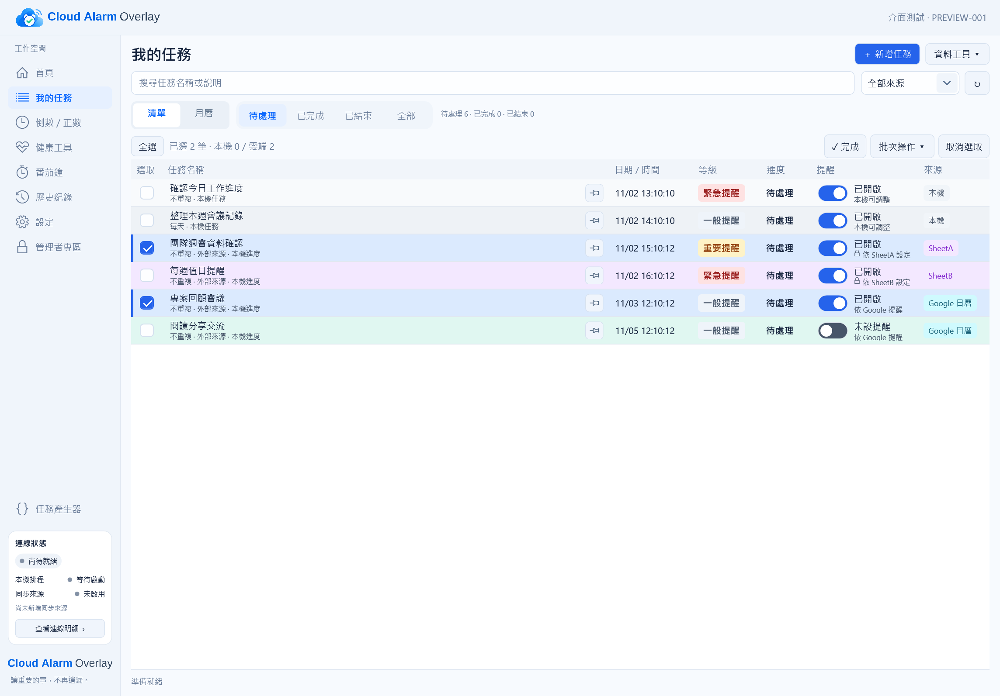
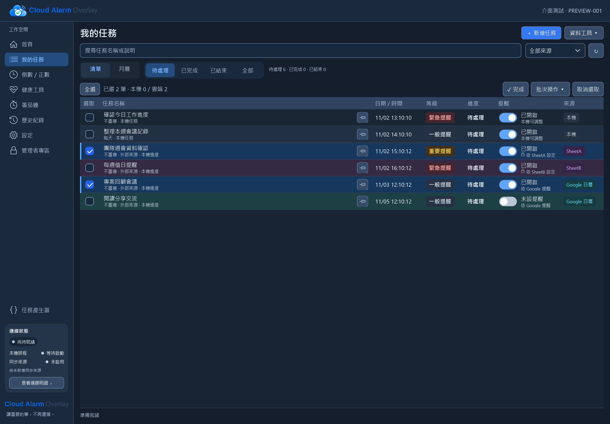
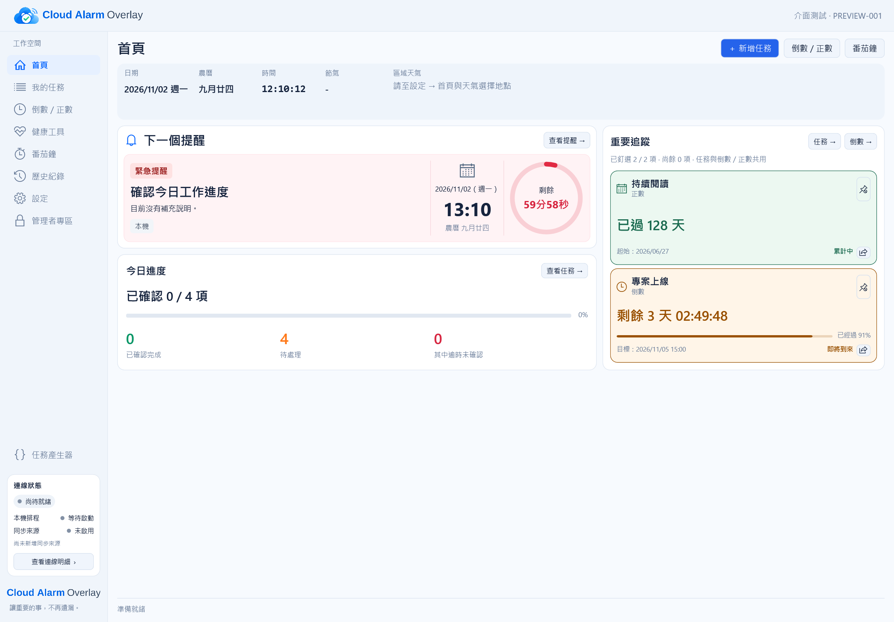
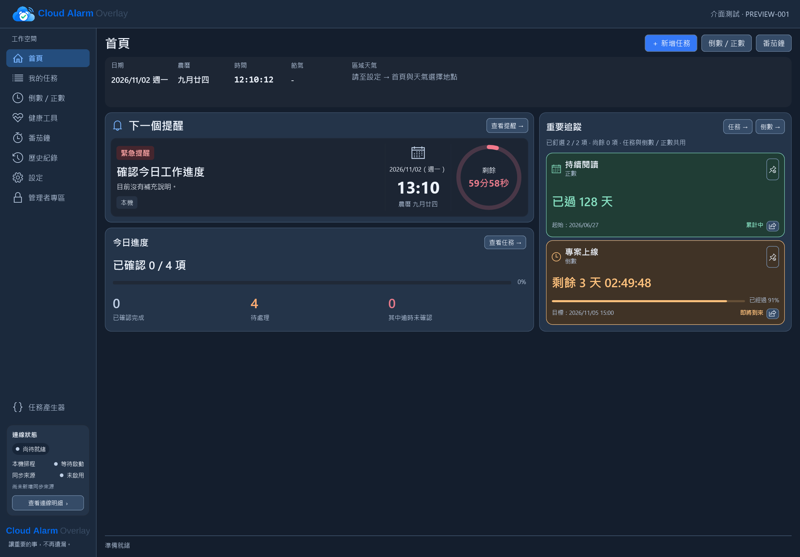

<div align="center">


# Cloud Alarm Overlay

常駐系統匣的 Windows 桌面提醒工具，整合本機任務、Google Sheets 團隊通知與 Google 日曆。

[](https://github.com/bruce-yang-422/cloud-alarm-overlay/releases/latest)
[](https://dotnet.microsoft.com/download/dotnet/10.0)
[](#系統需求)
[](LICENSE)

[下載](https://github.com/bruce-yang-422/cloud-alarm-overlay/releases/latest) · [產品網站](https://remind.stack-base.com/) · [使用指南](docs/使用指南.md) · [回報問題](https://github.com/bruce-yang-422/cloud-alarm-overlay/issues)

</div>

## 介面預覽

| 亮色模式 | 暗色模式 |
| --- | --- |
| [](site-assets/screenshots/tasks_light.png) | [](site-assets/screenshots/tasks_dark.png) |
| [](site-assets/screenshots/home_light.png) | [](site-assets/screenshots/home_dark.png) |

其他畫面：[番茄鐘](site-assets/screenshots/pomodoro_light.png) · [倒數／正數](site-assets/screenshots/countdown_light.png) · [事件編輯](site-assets/screenshots/countdown_editor_light.png) · [提醒通知](site-assets/screenshots/notification_light.png)

## 主要功能

- **任務與月曆**：建立一次性或重複提醒，支援工作日、每週複選、每月指定日期與月份、國曆及農曆規則；可略過假日，並以清單或月曆檢視。
- **任務進度**：依待處理、已完成、已結束與全部分區管理；支援單筆或批次完成、恢復與復原。重複任務以單次發生時間記錄進度。
- **分級通知**：提供一般、重要、緊急與強制通知；可依政策延後提醒，最高級通知須輸入確認碼。
- **多來源同步**：讀取公開 Google Sheets，並可使用 Google 帳號連接私人試算表及自己的 Google 日曆。
- **任務產生器**：使用隨附的瀏覽器表單挑選員工、產生資料列並匯出 CSV 或 Excel，供管理者更新試算表。
- **計時與健康**：倒數／正數、番茄鐘，以及喝水、久坐、螢幕休息與伸展提醒。
- **首頁與外觀**：任務摘要、首頁釘選、天氣與氣象警特報，支援明暗模式與多種色彩風格。
- **管理與稽核**：公司政策、來源設定、存取控制、歷史紀錄、CSV 匯出、備份與還原。

## 系統需求

- Windows x64；安裝套件已包含 .NET 執行階段。
- Google 同步、天氣、警特報與更新檢查需要網路；本機任務可離線執行。

## 安裝

1. 從 [GitHub Releases](https://github.com/bruce-yang-422/cloud-alarm-overlay/releases/latest) 下載 `CloudAlarmOverlay-v<版本>-Setup-x64.exe`。
2. 依該版本發布說明核對 SHA-256：

   ```powershell
   Get-FileHash -LiteralPath '.\CloudAlarmOverlay-v<版本>-Setup-x64.exe' -Algorithm SHA256
   ```

3. 執行安裝精靈，完成後從開始功能表啟動。

既有版本可覆蓋安裝，保留本機任務、設定及歷史紀錄；升級前建議先備份。詳細操作及 SmartScreen 說明見[安裝教學](docs/安裝教學.md)。

## 快速開始

1. 首次啟動時，選擇「個人使用」或「公司使用」，也可匯入 `.calbak` 備份。
2. 個人使用確認顯示名稱；公司使用填入管理者提供的裝置代碼與顯示名稱。
3. 在「我的任務」建立任務，設定時間、內容、通知等級與重複規則。
4. 到「設定」調整外觀、天氣地區及所需整合功能。

關閉主視窗會縮至系統匣，背景提醒仍持續執行；要停止程式，請從系統匣選單選擇「結束程式」。

> [!IMPORTANT]
> 公司使用模式有預設管理者帳密，首次設定後請立即變更，詳見[使用指南](docs/使用指南.md#使用方式)。

## 文件

| 文件 | 內容 |
| --- | --- |
| [使用指南](docs/使用指南.md) | 使用方式、通知等級、Google 整合、資料與備份。 |
| [安裝教學](docs/安裝教學.md) | 下載、SmartScreen 與首次啟動。 |
| [管理員設定指南](docs/管理員JSON設定匯入.md) | JSON 設定匯入及匯出。 |
| [健康工具](docs/健康工具.md) | 喝水、久坐、螢幕休息與伸展提醒。 |
| [氣象署警特報](docs/氣象署警特報.md) | 警特報來源與限制。 |
| [常用 CLI 指令](docs/常用CLI指令.md) | 建置、測試、封裝與發布。 |
| [Google 整合待辦](docs/Google帳號與同步設定.md) | 尚未實作的 Google 整合項目。 |
| [發布說明](https://github.com/bruce-yang-422/cloud-alarm-overlay/releases) | 各版本更新內容與升級須知。 |

## 從原始碼建置

需要 [global.json](global.json) 指定的 .NET 10 SDK，且須在 Windows 上建置：

```powershell
git clone https://github.com/bruce-yang-422/cloud-alarm-overlay.git
Set-Location cloud-alarm-overlay
dotnet restore CloudAlarmOverlay.sln --locked-mode
dotnet run --project src/CloudAlarmOverlay.App
```

測試、專案結構與 Pull Request 規範見[貢獻指南](CONTRIBUTING.md)。

## 貢獻

歡迎回報問題與提交 Pull Request，開始前請先閱讀[貢獻指南](CONTRIBUTING.md)。

## 授權

本專案採用 [MIT License](LICENSE)。Emoji 素材授權見 [Emoji LICENSE](src/CloudAlarmOverlay.App/Assets/Emoji/LICENSE.txt)；任務產生器的第三方資源見[資源說明](task-builder-assets/README.md)。

天氣資料來自 [Open-Meteo](https://open-meteo.com/en/docs)，使用限制與來源標示見服務文件；氣象警特報來源與限制見[氣象署警特報](docs/氣象署警特報.md)。
