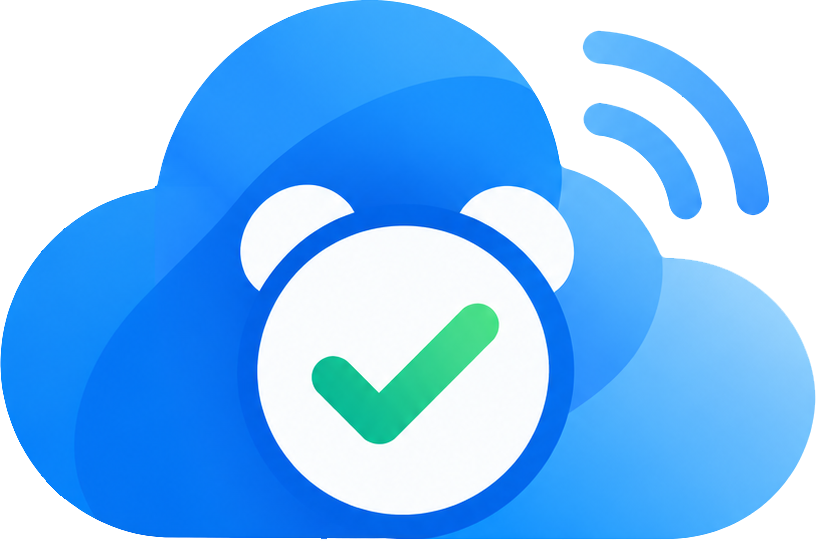

# Cloud Alarm Overlay

[](https://github.com/bruce-yang-422/cloud-alarm-overlay/releases/latest)
[](https://dotnet.microsoft.com/download/dotnet/10.0)
[](#系統需求)
[](LICENSE)

Windows 桌面提醒工具，整合本機任務、Google Sheets 團隊通知、Google 日曆、倒數計時、番茄鐘與健康提醒。程式常駐系統匣，支援離線本機排程，並分別記錄通知簽收與任務完成進度。

[下載最新發布版本](https://github.com/bruce-yang-422/cloud-alarm-overlay/releases/latest) · [產品網站](https://remind.stack-base.com/) · [v1.4.4 發布說明](docs/v1.4.4發布說明.md) · [回報問題](https://github.com/bruce-yang-422/cloud-alarm-overlay/issues)

> 原始碼版本為 **1.4.4**。可下載的公開版本與安裝檔，以 GitHub Releases 實際發布內容為準。

## 目錄

- [主要功能](#主要功能)
- [系統需求](#系統需求)
- [安裝與升級](#安裝與升級)
- [快速開始](#快速開始)
- [通知與任務進度](#通知與任務進度)
- [Google Sheets 與帳號整合](#google-sheets-與帳號整合)
- [資料儲存與備份](#資料儲存與備份)
- [開發與測試](#開發與測試)
- [建置安裝套件](#建置安裝套件)
- [專案結構](#專案結構)
- [文件](#文件)
- [貢獻指南](#貢獻指南)
- [授權](#授權)

## 主要功能

- **任務與月曆**：建立一次性或重複提醒，支援工作日、每週複選、每月指定日期與月份、國曆及農曆規則；可略過假日，並以清單或月曆檢視。
- **任務進度**：依待處理、已完成、已結束與全部分區管理；支援單筆或批次完成、恢復與復原。重複任務以單次發生時間記錄進度。
- **分級通知**：提供一般、重要、緊急與強制通知；可依政策延後提醒，最高級通知須輸入確認碼。
- **多來源同步**：讀取公開 Google Sheets，並可使用 Google 帳號連接私人試算表及自己的 Google 日曆。
- **任務產生器**：使用隨附的瀏覽器表單挑選員工、產生資料列並匯出 CSV 或 Excel，供管理者更新試算表。
- **計時與健康**：倒數／正數、番茄鐘，以及喝水、久坐、螢幕休息與伸展提醒。
- **首頁與外觀**：任務摘要、首頁釘選、天氣與氣象警特報，支援明暗模式與多種色彩風格。
- **管理與稽核**：公司政策、來源設定、存取控制、歷史紀錄、CSV 匯出、備份與還原。

## 系統需求

| 項目 | 需求 |
| --- | --- |
| 執行環境 | Windows x64；自包含安裝套件已包含 .NET 執行階段。 |
| 網路 | Google 同步、天氣、警特報與更新檢查需要網路；本機任務可離線執行。 |
| 原始碼建置 | .NET 10 SDK；指定版本見 [global.json](global.json)。 |
| 安裝套件建置 | Inno Setup 6 或 7。 |

## 安裝與升級

1. 前往 [GitHub Releases](https://github.com/bruce-yang-422/cloud-alarm-overlay/releases/latest)，下載 `CloudAlarmOverlay-v<版本>-Setup-x64.exe`。
2. 依該版本發布說明核對 SHA-256，執行繁體中文安裝精靈。
3. 安裝完成後，從開始功能表啟動 Cloud Alarm Overlay。

驗證安裝檔的指令：

```powershell
Get-FileHash -LiteralPath '.\CloudAlarmOverlay-v1.4.4-Setup-x64.exe' -Algorithm SHA256
```

既有版本可覆蓋安裝，保留本機任務、設定及歷史紀錄。升級前請備份並儲存編輯內容；安裝器會結束同一安裝路徑的舊程式。詳細操作及 SmartScreen 說明見[安裝教學](docs/安裝教學.md)。

## 快速開始

1. 首次啟動時，選擇「個人使用」或「公司使用」，也可匯入 `.calbak` 備份。
2. 個人使用確認顯示名稱；公司使用填入管理者提供的裝置代碼與顯示名稱。
3. 在「我的任務」建立任務，設定時間、內容、通知等級與重複規則。
4. 到「設定」調整外觀、天氣地區及所需整合功能。

| 行為 | 個人使用 | 公司使用 |
| --- | --- | --- |
| 管理者專區 | 直接開放 | 需輸入管理者帳密；登入 10 分鐘後自動登出。 |
| 結束程式 | 預設不需密碼，可另設專用結束密碼。 | 依公司密碼保護政策。 |

公司使用的預設管理者帳號為 `admin`，密碼為 `12345`；首次設定後請變更密碼。使用方式在首次設定時選定，匯入設定或備份不會切換模式。

關閉主視窗會縮至系統匣，背景提醒仍持續執行。要停止程式，請從系統匣選單選擇「結束程式」。

## 通知與任務進度

| 等級 | 呈現方式 | 確認要求 |
| --- | --- | --- |
| 一般提醒 | 右下角小視窗，10 秒後自動關閉；滑鼠移入會暫停倒數。 | 可手動確認。 |
| 重要提醒 | 右下角置頂視窗。 | 按鈕確認。 |
| 緊急提醒 | 畫面中央的大型置頂視窗。 | 按鈕確認；能否延後由管理者政策控制。 |
| 強制通知 | 全螢幕置頂通知，由公司或系統雲端任務指派。 | 輸入畫面上的 9 位數字確認碼。 |

自 v1.4.4 起，對應現有任務的通知視窗提供兩種操作：

- **只確認已讀**：記錄通知簽收並關閉視窗，保留任務進度；超過預定時間且未完成的任務仍會顯示「逾期」。
- **已完成**：記錄通知簽收與本次任務完成狀態，完成紀錄可在「已完成」分區查看。重複任務保留後續排程。

強制通知的兩種操作均須通過確認碼驗證。預覽、倒數、健康工具與番茄鐘通知不提供此任務完成操作。一般提醒自動關閉僅記錄提醒確認，不會自動完成任務。

外部來源任務的完成紀錄儲存在本機，不會因這些操作修改雲端任務。清單與月曆也可手動標記完成或恢復待處理。

## Google Sheets 與帳號整合

### 公司共用試算表

1. 依 [CSV 範例](Sheet範例/) 建立 Sheet A（`Tasks`、`Holidays`、`Employees`、`LunarCalendar`）與 Sheet B（`Tasks`）。
2. 設定試算表可透過公開 CSV 連結讀取，記下 Spreadsheet ID 與各分頁 GID。
3. 在「管理者專區 → 共用試算表」填入來源，測試連線後儲存並同步。

公開 CSV 同步不需要 API 金鑰，同步間隔可設為 30～60 秒，預設 45 秒。網路中斷時使用已快取資料；公開來源同步不會將本機資料寫回試算表。

`Recurrence` 範例：`WEEKLY:1,4` 表示每週一、四；`Monthly:10` 表示每月 10 日。含逗號的欄位必須使用 CSV 雙引號，例如 `"WEEKLY:1,4"`。內建農曆與假日涵蓋 2026–2027 年，資料格式見[日曆資料說明](data/calendar/README.md)。

### Google 帳號

在「設定 → Google 帳號與同步」連接私人 Sheets 與自己的 Google 日曆。Google 登入是否可用，取決於建置時的 OAuth 設定與專案授權狀態；Sheets 線上編輯須另行授權及啟用。可在相同設定頁管理來源與重新登入；尚未實作的擴充見 [Google 整合待辦](docs/Google帳號與同步設定.md)。

### 任務產生器

從側邊欄或系統匣開啟「任務產生器」，填寫表單後複製資料列或匯出檔案，再更新 Google Sheets。表單本身不會自動修改試算表，也不需額外安裝 Python 或 Node.js。

「重新同步雲端資料」會讀取設定中的 Sheet B 任務與 Sheet A 員工名單。修改專案內的範例 CSV 不會自動更新雲端；員工異動須更新雲端 `Employees` 分頁後重新同步。

## 資料儲存與備份

```text
%AppData%\CloudAlarmOverlay\cloud_alarm_overlay.db
%AppData%\CloudAlarmOverlay\logs\runtime-yyyyMMdd.log
```

- 在「管理者專區 → 備份與移轉」建立或還原 `.calbak` 備份；還原後請重新啟動。
- Google 授權不包含在備份中，移轉電腦後需重新登入。
- JSON 設定匯入及匯出操作見[管理員設定指南](docs/管理員JSON設定匯入.md)。
- 執行日誌預設保留 30 天，可調整為 1～365 天。

更新來源設定在「管理者專區 → 啟動與更新」：

```text
https://raw.githubusercontent.com/bruce-yang-422/cloud-alarm-overlay/main/version.json
```

`version.json` 指向已公開發布的安裝檔；只有完成封裝不會變更線上可下載版本。

## 開發與測試

安裝 [global.json](global.json) 指定的 SDK 後執行：

```powershell
git clone https://github.com/bruce-yang-422/cloud-alarm-overlay.git
Set-Location cloud-alarm-overlay
dotnet restore CloudAlarmOverlay.sln --locked-mode
dotnet run --project src/CloudAlarmOverlay.App
```

Release 建置與完整測試：

```powershell
dotnet build CloudAlarmOverlay.sln -c Release --no-restore
dotnet test CloudAlarmOverlay.sln -c Release --no-build --no-restore
```

WPF 測試須在 Windows 執行。若 DLL 被占用，請先從系統匣結束相關程式。Google 登入建置須提供桌面 OAuth 設定；本機檔案名稱為 `google-desktop-oauth.local.json`，應包含桌面用戶端的 `installed` 設定並保留於 Git 忽略清單。

## 建置安裝套件

更新 [Directory.Build.props](Directory.Build.props) 的版本後執行：

```powershell
.\installer\build-installer.ps1 -Version 1.4.4
```

腳本以 Windows x64 自包含方式發布，再呼叫 Inno Setup；可用 `-Iscc` 指定編譯器。輸出位置：

| 路徑 | 內容 |
| --- | --- |
| `artifacts/publish/` | 自包含程式與隨附資源。 |
| `artifacts/installer/` | `CloudAlarmOverlay-v1.4.4-Setup-x64.exe` 安裝檔與校驗檔。 |

發布順序為：完成測試與封裝、計算 SHA-256、建立 GitHub Release 並上傳產物、下載核對產物，再更新 `version.json`。封裝版本必須高於 `version.json` 的已發布版本；既有版本產物不得覆寫。

## 專案結構

| 路徑 | 用途 |
| --- | --- |
| `src/CloudAlarmOverlay.App/` | WPF 介面、通知視窗與系統匣。 |
| `src/CloudAlarmOverlay.Core/` | 任務模型、排程、重複規則與 CSV 解析。 |
| `src/CloudAlarmOverlay.Data/` | SQLite、資料庫遷移及備份還原。 |
| `src/CloudAlarmOverlay.BackgroundServices/` | 同步與提醒背景工作。 |
| `src/CloudAlarmOverlay.Infrastructure/` | 網路、檔案路徑與系統服務。 |
| `tests/` | 資料層及 WPF 自動化測試。 |
| `installer/` | Inno Setup 腳本與封裝工具。 |
| `tools/task-builder/` | 任務產生器資源建置與離線測試。 |
| `data/calendar/` | 內建農曆與假日資料。 |
| `docs/` | 使用手冊、技術文件及發布說明。 |
| `Sheet範例/` | Google Sheets 公開 CSV 範例。 |

## 文件

- [v1.4.4 發布說明](docs/v1.4.4發布說明.md)
- [v1.4.3 發布說明](docs/v1.4.3發布說明.md)
- [安裝教學](docs/安裝教學.md)
- [Google 整合待辦](docs/Google帳號與同步設定.md)
- [健康工具](docs/健康工具.md)
- [氣象署警特報](docs/氣象署警特報.md)
- [常用 CLI 指令](docs/常用CLI指令.md)

## 貢獻指南

請先搜尋 [Issues](https://github.com/bruce-yang-422/cloud-alarm-overlay/issues)，確認問題或需求尚未有人回報。錯誤回報請提供程式版本、Windows 版本、重現步驟、預期結果與實際結果，並移除日誌或截圖中的私人資料。

提交 Pull Request 時，請說明變更目的、使用者可見行為及驗證結果；功能變更應更新相關文件，並加入適當的回歸測試。請遵循現有程式風格，避免提交建置產物、個人資料、服務帳戶私鑰或本機連線設定。

## 授權

本專案採用 [MIT License](LICENSE)。Emoji 素材授權見 [Emoji LICENSE](src/CloudAlarmOverlay.App/Assets/Emoji/LICENSE.txt)；任務產生器的第三方資源見[資源說明](task-builder-assets/README.md)。

天氣資料來自 [Open-Meteo](https://open-meteo.com/en/docs)，使用限制與來源標示見服務文件；氣象警特報來源與限制見[氣象署警特報](docs/氣象署警特報.md)。
